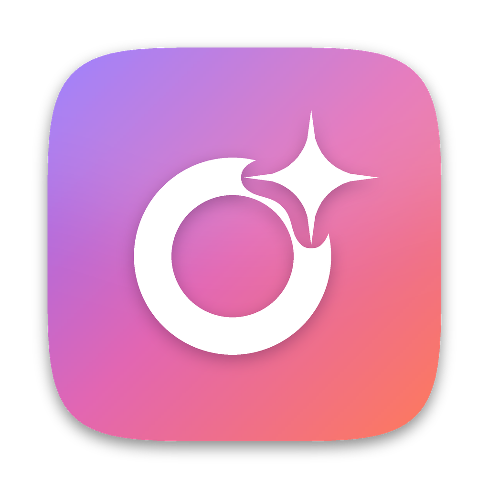

<p align="center"></p>

<h1 align="center">OxoAI</h1>

<p align="center"><b>Ton espace de travail IA, sur ta propre machine.</b><br>
Chat, agents, code, bases de connaissances et entraînement de modèles, avec des modèles qui
tournent en local. Gratuit, open source, sans compte et sans télémétrie.</p>

<p align="center">
  <a href="LICENSE"></a>
  
  
</p>

<p align="center"><sub>OxoAI est une version modifiée de <a href="https://github.com/medhiclb/HelixAI">HelixAI</a>,
de Medhi Clabaut (Helix Agence). De la même famille que <a href="https://github.com/martinleonardcyber-ops/oxoflow">OxoFlow</a>.</sub></p>

## Pourquoi OxoAI

- **Local par défaut.** Les modèles tournent sur ta machine grâce au moteur de
  [LM Studio](https://lmstudio.ai), qu'OxoAI installe avec le modèle adapté à sa mémoire.
  Aucun modèle cloud n'est choisi à ta place.
- **Rien ne sort sans ta clé.** Une conversation ne part chez un fournisseur cloud que si tu
  ajoutes sa clé d'API et choisis un de ses modèles.
- **Open source, rien à acheter.** Licence AGPL-3.0, aucun compte, aucune télémétrie.
- **macOS, Windows et Linux**, avec une interface en français, anglais, espagnol, allemand,
  arabe, chinois et japonais.

## Fonctions

- **Chat** avec des modèles locaux choisis pour ta machine (Qwen, Mistral, gpt-oss, GLM,
  Granite, OLMo…), ou des modèles cloud avec ta propre clé. Pièces jointes, dictée (Whisper),
  images et courtes vidéos générées sur la machine.
- **Recherche sur le web** dans le Chat, avec les sources en liens.
- **Bases de connaissances (RAG)** : tes documents indexés sur la machine, des réponses qui
  citent les passages utilisés.
- **Cowork** : un agent qui produit des documents Word, Excel, PowerPoint et PDF à partir de
  tes fichiers.
- **OxoAI Code** : un agent de code sur ton projet (bâti sur OpenCode), aussi dans VS Code et
  dans le terminal avec la commande `oxoai`.
- **Connecteurs** : mail, Google Agenda et Drive, Slack, Notion, serveurs MCP… Rien qui modifie
  quelque chose ne se fait sans ton accord.
- **Agents et tâches programmées** qui continuent de tourner fenêtre fermée et laissent un
  compte rendu de chaque passage.
- **Entraînement** : apprends à un petit modèle ouvert tes propres faits à partir d'exemples de
  questions et de réponses (MLX sur puce Apple).

## Installation

Les premières versions téléchargeables d'OxoAI arrivent bientôt dans les
[publications](https://github.com/martinleonardcyber-ops/oxoai/releases). En attendant, tu peux
le lancer depuis les sources.

## Lancer depuis les sources

```bash
git clone https://github.com/martinleonardcyber-ops/oxoai.git
cd oxoai
npm ci
```

Puis, dans deux terminaux :

```bash
npm run dev
```

```bash
npm run app
```

- `npm run dev` sert l'interface ; `npm run app` construit la passerelle et ouvre l'application.
- `npm run package` fabrique le paquet de ton système dans `release/`.
- `npm run typecheck`, `npm run securite` et `node scripts/i18n.mjs` sont les vérifications à
  passer avant de proposer une modification.
- `scripts/marque/oxoai_marque.py` régénère l'icône et le logo.

## Documentation

Les documents d'origine de HelixAI sont gardés tels quels, car ils restent la meilleure
description du fonctionnement interne : [ARCHITECTURE.md](ARCHITECTURE.md),
[SECURITE.md](SECURITE.md) et [PROJET.md](PROJET.md). Ils parlent de « Helix », le nom
d'origine du projet. Le guide d'utilisation est dans [docs/GUIDE.md](docs/GUIDE.md).

## Licence et crédits

OxoAI est publié sous [GNU AGPL-3.0](LICENSE), comme HelixAI dont il est dérivé. Qui le
distribue, ou le propose comme service en ligne, doit publier le code complet de sa version.

Le code d'origine est © 2026 Medhi Clabaut (Helix Agence) ; ce qui a changé dans OxoAI, et
quand, est décrit dans [COPYRIGHT.md](COPYRIGHT.md). OxoAI n'est pas affilié à HelixAI ni à
Helix Agence. Les logiciels tiers inclus sont listés dans
[THIRD_PARTY_NOTICES.md](THIRD_PARTY_NOTICES.md).

Pour contribuer : [CONTRIBUTING.md](CONTRIBUTING.md).
